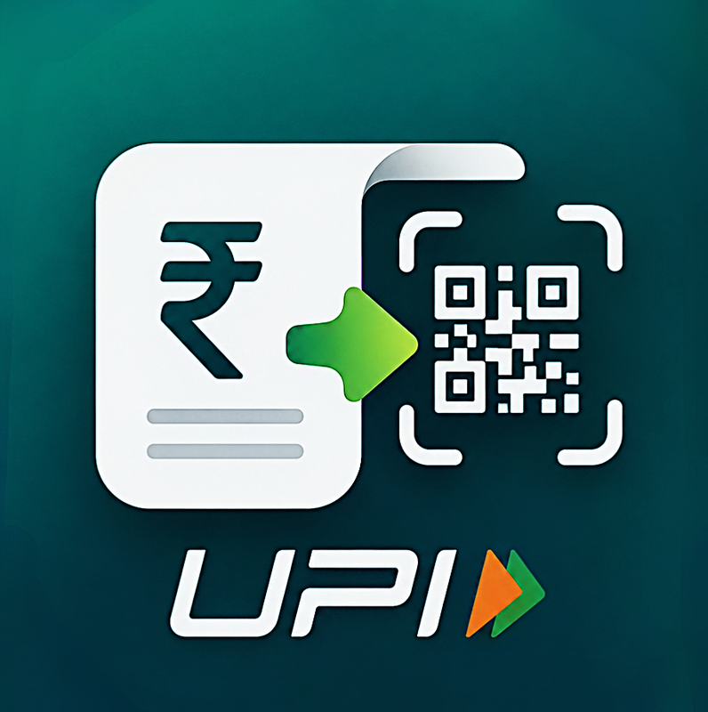
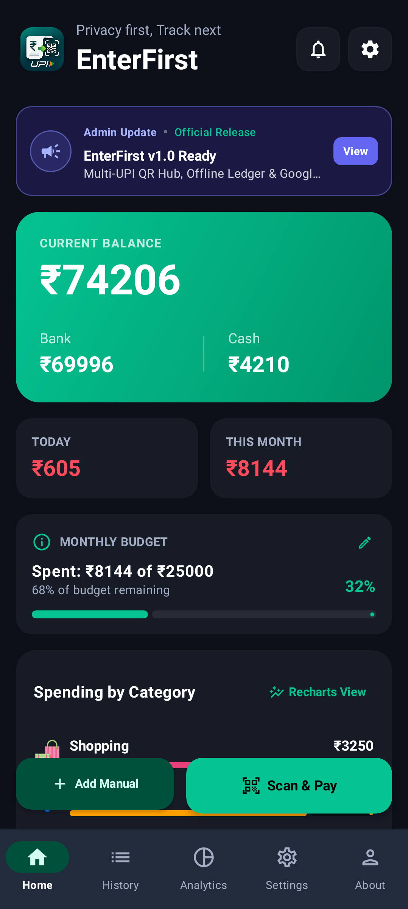
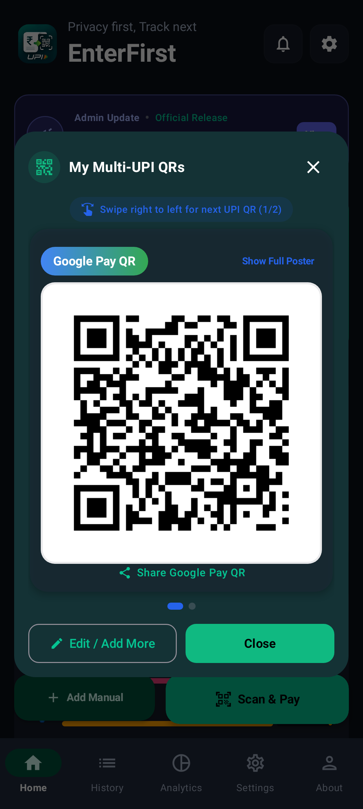
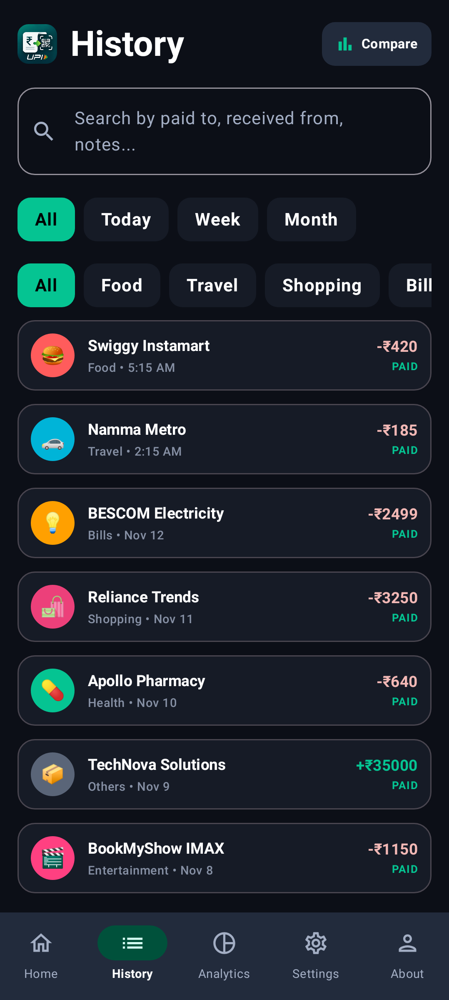
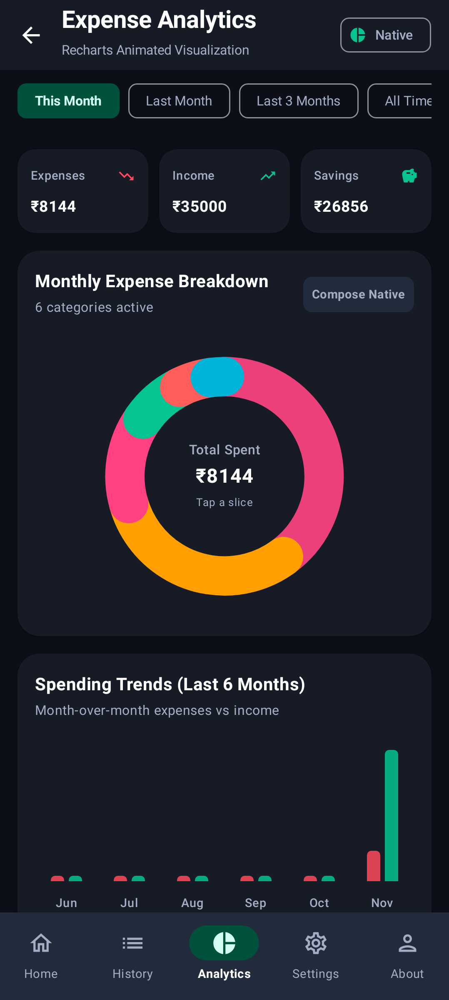
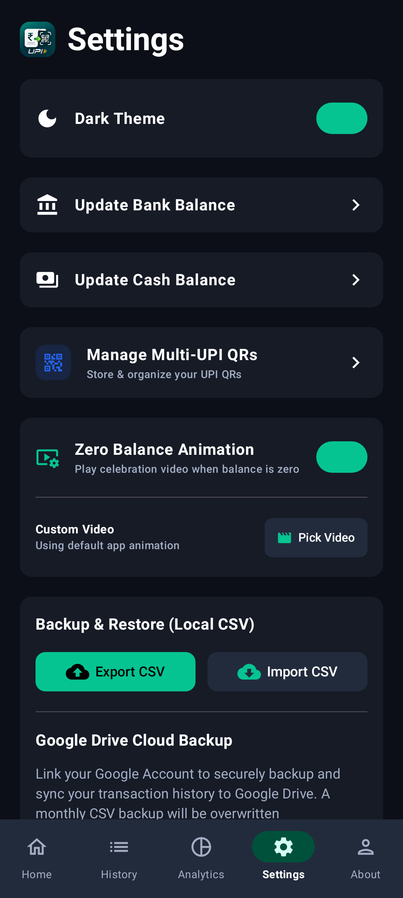

<div align="center">
  

  <h1>EnterFirst — Privacy First, Track Next</h1>

  <p>
    <strong>A privacy-first Android expense tracker &amp; Multi-UPI QR Hub built with Kotlin &amp; Jetpack Compose.</strong><br/>
    Scan once, record expenses before paying, manage all your UPI QR codes in one tap, and keep full control over your financial data.
  </p>

  <p>
    
    
    
    
  </p>

  <p>
    <a href="https://drive.google.com/uc?export=download&id=1ml0j1Wyu-12ipUA843LD0IjCweDBy2Wg" target="_blank">
      
    </a>
  </p>
</div>

---

## ✨ Why EnterFirst?

Most expense trackers demand invasive SMS permissions, bank credentials, or cloud sign-ins before letting you log a single rupee.

**EnterFirst** flips the workflow: **enter first, pay next** — completely offline-first, with zero SMS reading and zero bank account linking.

Your financial data stays under your control.

---

## 📥 Download APK

Want to try **EnterFirst** directly on your Android device?

<p align="left">
  <a href="https://drive.google.com/uc?export=download&id=1ml0j1Wyu-12ipUA843LD0IjCweDBy2Wg" target="_blank">
    
  </a>
</p>

👉 **[Click here to Download EnterFirst APK](https://drive.google.com/uc?export=download&id=1ml0j1Wyu-12ipUA843LD0IjCweDBy2Wg)**

**Installation Instructions:**

1. Click the download button above.
2. Download the APK file to your Android device.
3. Open the downloaded `.apk` file.
4. If prompted, allow installation from unknown sources for your browser or file manager.
5. Complete the installation and start using EnterFirst!

**Requirements:** Android 7.0 (Nougat) or newer.

> Note: If Google Drive displays a confirmation page instead of downloading directly, tap the Download option. The file must be shared with "Anyone with the link" access.

---

## 📱 App Screenshots

<div align="center">
  <table>
    <tr>
      <td align="center" width="33%">
        <br/>
        <strong>🏠 Home Dashboard</strong><br/>
        <sub>Live Bank &amp; Cash split, daily/monthly spend &amp; budget meter</sub>
      </td>
      <td align="center" width="33%">
        <br/>
        <strong>📲 Multi-UPI QR Hub</strong><br/>
        <sub>Tap the top-left logo &amp; swipe across GPay, Paytm, PhonePe &amp; more</sub>
      </td>
      <td align="center" width="33%">
        <br/>
        <strong>📜 Smart History</strong><br/>
        <sub>Filter by time, category &amp; payment mode with instant search</sub>
      </td>
    </tr>
  </table>

  <table>
    <tr>
      <td align="center" width="50%">
        <br/>
        <strong>📊 Visual Analytics</strong><br/>
        <sub>Interactive category donut charts, monthly trends &amp; savings insights</sub>
      </td>
      <td align="center" width="50%">
        <br/>
        <strong>⚙️ Settings &amp; Auto-Backup</strong><br/>
        <sub>Manage Multi-UPI QRs, Dark/Light theme &amp; Google Drive backups</sub>
      </td>
    </tr>
  </table>
</div>

---

## 🚀 Key Features

- **⚡ Scan & Pay UPI Workflow** — Scan merchant QR codes using **CameraX + Google ML Kit** (or pick from gallery), enter the amount, categorize the expense first, and launch your preferred UPI app seamlessly.

- **📲 Multi-UPI QR Hub (Quick Logo Access)** — Store QR codes from **Google Pay, Paytm, PhonePe, BHIM, Navi, Cred, Amazon Pay**, or custom UPI apps locally. Tap the top-left app logo anytime to view zoomed 1:1 QR codes and swipe left/right between them, or reorder & edit them from **Settings → Manage Multi-UPI QRs**.

- **💰 Offline-First Balance & Budget Ledger** — Track **Bank** and **Cash** balances separately with custom category chips, monthly budget progress alerts, and a **Built-in Calculator Keypad** for quick math while logging transactions.

- **📊 Rich Analytics & Comparisons** — Switch between native Jetpack Compose charts and interactive **Recharts** visualizations, compare financial parameters across periods, and track net savings.

- **🧾 Receipt Attachments & OCR** — Attach payment receipts or screenshots via the zero-permission Android Photo Picker and extract transaction details with **ML Kit Text Recognition**.

- **☁️ Optional Google Drive Auto-Backup & CSV Export** — Export transactions to CSV anytime or link your Google account for scheduled **Daily, Weekly, or Monthly** backups to your personal Google Drive (`drive.file` scope).

---

## 🛠️ Tech Stack & Architecture

| Layer | Technology |
| :--- | :--- |
| **Language** | Kotlin (`2.2.10`) with Coroutines & StateFlow |
| **UI Framework** | Jetpack Compose + Material Design 3 (Edge-to-Edge) |
| **Architecture** | MVVM (`FinanceViewModel` + `FinanceRepository`) |
| **Local Database** | Room (`AppDatabase`, DAOs for Transactions, Preferences & Announcements) |
| **Camera & Scanning** | CameraX, ML Kit Barcode Scanning, ML Kit Text Recognition, ZXing |
| **Background Sync** | WorkManager, Exact Alarms & Boot Receivers |
| **Cloud Backup (Optional)** | Google Sign-In (`play-services-auth`) + Google Drive REST API v3 via OkHttp |
| **Image Loading & Motion** | Coil (`coil-compose`, `coil-gif`), Lottie Compose |
| **Testing** | JUnit4, Robolectric, Compose UI Test & Roborazzi |

---

## 💻 Run Locally

### Prerequisites

- [Android Studio](https://developer.android.com/studio) (Ladybug or newer recommended)
- Android SDK 36 (Min SDK 24)
- JDK 11+

### Setup Steps

1. **Clone the repository**

   ```bash
   git clone <your-repo-url>
   cd <project-folder>
   ```

2. **Open in Android Studio**

   Select **Open** and choose the root project directory. Let Gradle sync all dependencies.

3. **Configure Environment Variables (Optional)**

   Copy `.env.example` to `.env` if you use custom Secrets Gradle Plugin keys:

   ```bash
   cp .env.example .env
   ```

4. **Build & Run**

   Select a physical Android device or emulator and click **Run**.

   Alternatively, execute:

   ```bash
   gradle :app:assembleDebug
   ```

---

## 📄 Documentation & Developer

- **User Manual:** See [`EnterFirst_User_Manual.pdf`](EnterFirst_User_Manual.pdf)

- **Developer:** **S Divya Darshan**

- **Email:** [sddarshan2007@gmail.com](mailto:sddarshan2007@gmail.com)

- **LinkedIn:** [S Divya Darshan](https://www.linkedin.com/in/s-divyadarshan-796076376/)

- **Instagram:** [@_.daxrshnxz](https://www.instagram.com/_.daxrshnxz/)

---

<div align="center">
  <h3>💚 EnterFirst — Your Money. Your Data. Your Control.</h3>
  <p>Made with ❤️ by S Divya Darshan</p>
</div>
